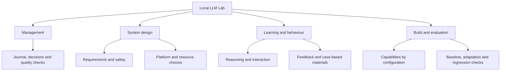

# Local LLM Lab Showcase

Oleksandra is developing a research method and technical plan for a local language model that adapts to one person. The lab documents how she sets the research direction, how agents carry out and check the work, and how results are evaluated.

**Current stage:** research and planning. The lab has produced requirements, reconciled independent safety studies, and a branching roadmap draft with an independent review. The local model, system integrations and adaptation experiments are planned.

[Competencies and evidence](competencies/README.md) · [Lab progress, 13–20 November 2026](evidence/2026-11-20-lab-progress.md) · [Roadmap](roadmap/README.md)

## Workstreams

Oleksandra defined four research streams for the plan:

| Stream | Question |
|---|---|
| Safety framework | How should the system protect the owner and constrain what the model can do across roles and devices? |
| Reasoning and behaviour | How can the system keep plausible interpretations open and respond proportionately to a correction? |
| Learning architecture | Which feedback should carry forward, and through what mechanism? |
| Case-based learning materials | How can examples teach reasoning about a situation and support staged evaluation? |

The [roadmap](roadmap/README.md) shows how the work branches with available resources and what must be in place before a capability can be added. [How we rebuilt the roadmap](cases/case-001.md) explains why the tree changed.

## How the lab works

Oleksandra sets the research goal and acceptance criteria, directs the work, reviews evidence and takes decisions. Agents research, draft, implement and document assigned work. An agent can review another agent's result independently, with each contribution credited to its author.

When work falls short, the lab records what happened, investigates contributing causes and checks what changed after a correction. In one case this produced [a branching roadmap with explicit assumptions and dependencies](cases/case-001.md). In another it led to [two independent safety studies and a recorded correction to a research claim](cases/case-002.md).

- [Methodology and quality checks](methodology/README.md)
- [Synthetic example of a working task journal](journal/synthetic-examples/README.md)
- [Cases](cases/README.md)
- [Evaluation evidence and planned checks](evidence/README.md)
- [Reusable templates](templates/README.md)

See the [licensing proposal](LICENSING.md) for the current status of reuse terms.
