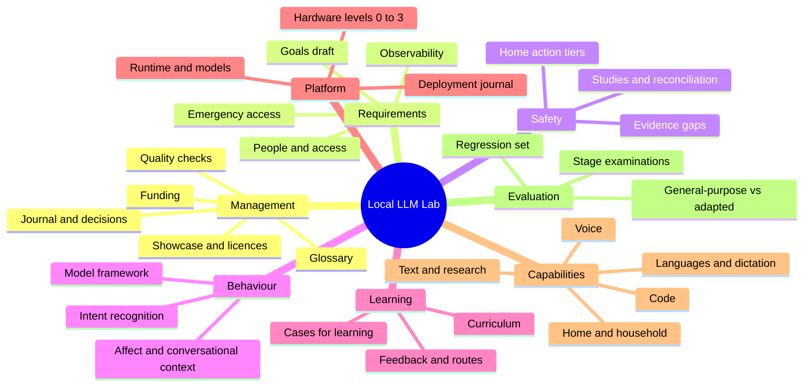
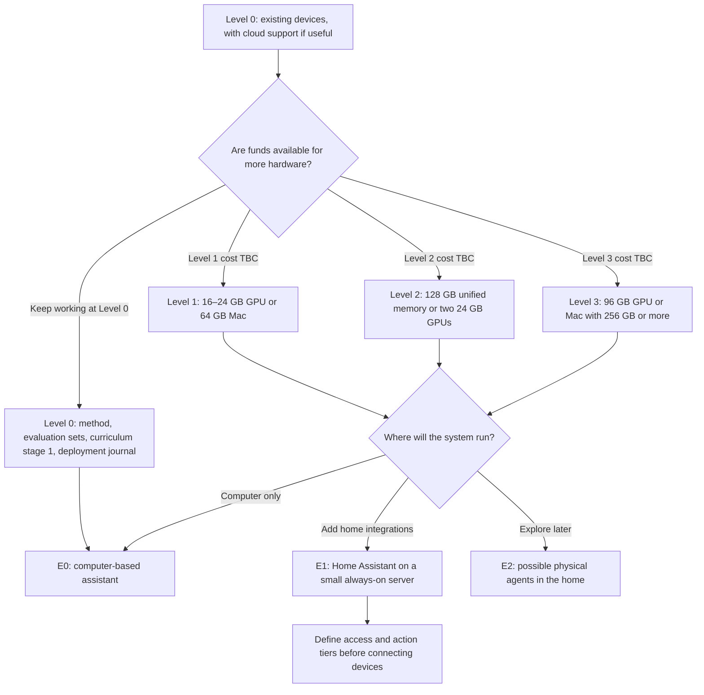
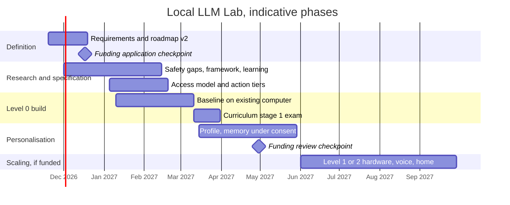
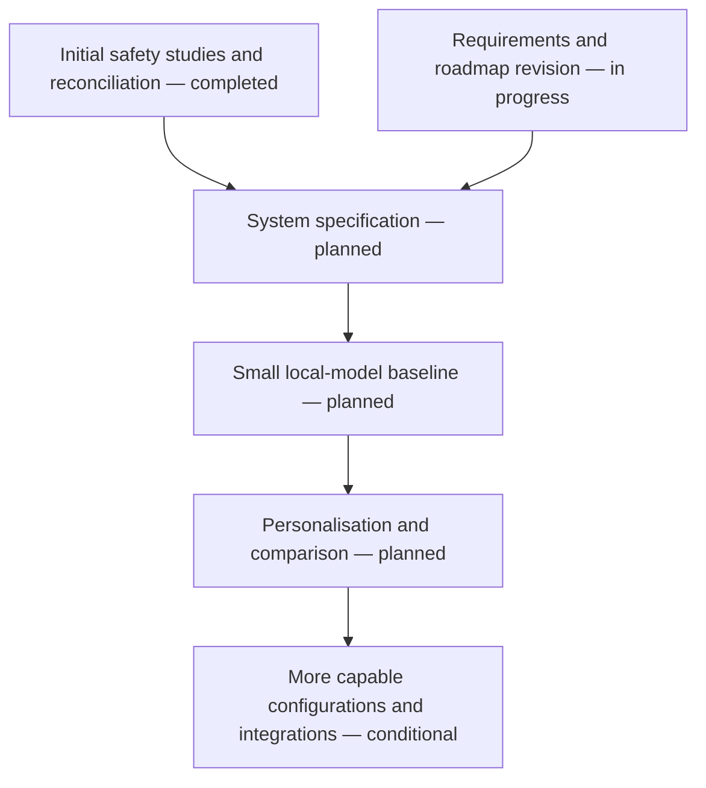

# Roadmap for a personal local language model

Public version of the November 2026 Roadmap v2 working draft. Claude Code prepared the draft, Oleksandra set its direction, and Codex reviewed it independently. The roadmap remains under revision. Hardware configurations, capabilities and dates are indicative.

## 1. From where to where

### Starting point and goal

**Baseline, 13 November 2026.** Oleksandra began with two candidate tools, Ollama and LM Studio, a 2019 Intel MacBook Pro with 16 GB of memory and an iPhone. The laptop provides a CPU-only starting point for the lab's local-model tests. She already used Claude Code through Claude Pro and Codex through ChatGPT Plus. The lab runs in her spare time alongside a full-time job. No local model or memory system had been set up at the baseline. See the [starting resources and working constraints](../evidence/2026-11-20-lab-progress.md#starting-resources-and-working-constraints).

**State of the work at the November review.** The journal and a two-agent workflow were in use. The lab had reconciled two safety studies, drafted product requirements and a staged curriculum, and researched funding and hardware options. The local model, personalisation and integrations remained planned.

**Target.** An owner-controlled local system that adapts to Oleksandra's language, way of thinking, interests and tasks. Possible uses include writing, research, literature, languages, learning, code, voice, home and household tasks, and personal finance support. Privacy, access and action limits apply across these uses.

**Variables.** The plan branches by available time, funding, hardware and open models. The system could run on a computer, extend to a smart home or eventually include physical devices. The [research streams](../README.md#workstreams) guide the work across these branches.

## 2. Build tree

## 3. Branches by resources and embodiment

### Branches by resources and capabilities

**Two directions under study.** A larger local system would follow the hardware levels below. In the hybrid direction, an adapted local core would consult selected cloud services without sending Oleksandra's private context or memory. It would adapt the returned answer locally and identify its source.

### Planning for different funding scenarios

Funding runs alongside the roadmap. Available resources determine which hardware paths the lab can consider, while research and evaluation continue at the current level. Each hardware purchase is a separate decision supported by dated evidence on cost and capability.

### Illustrative hardware levels

These configurations help compare options. Actual capacity depends on the model, quantisation, context size, runtime and workload.

| Level | Example configuration | Indicative cost | What it could enable |
|---|---|---|---|
| 0 | Existing Intel MacBook and iPhone; cloud API where useful | Existing devices and current subscriptions | Small-model baseline, method and evaluation work. The working draft does not plan local fine-tuning at this level. |
| 1 | Used PC with a 24 GB GPU, or a 64 GB Mac mini configuration | TBC | Evaluation of 14–32B models in suitable configurations, local voice and code assistance, and LoRA on 7–14B models where feasible |
| 2 | A 128 GB unified-memory system, with Strix Halo, DGX Spark or Mac Studio Max as examples to investigate, or two 24 GB GPUs | TBC | Evaluate 70B dense models at potentially limited speed and larger mixture-of-experts models such as gpt-oss-120b. Assess QLoRA with the chosen hardware and runtime. |
| 3 | A workstation with a 96 GB professional GPU, or a Mac Studio Ultra with 256 GB of unified memory or more | TBC | Evaluation of which tasks a larger local system can handle in place of cloud services |
| Parallel | Rented GPU for training | TBC | Run selected training experiments without purchasing hardware, using synthetic or non-sensitive data |

**Power continuity.** The working draft estimates 25–40 W for a small always-on home hub and router. A 1 kWh battery is an illustrative starting point for roughly a day of backup. Verify real draw and conversion losses before selecting equipment.

## 4. Phases

The chart is an illustrative schedule from the working draft. The funding checkpoints are planning assumptions. Each phase starts when its entry condition is met.

### Stages and dependencies

| Phase | Work | Entry condition | Completion criterion | Owner decisions |
|---|---|---|---|---|
| P0 · Foundation | Journal, agents and working rules | Project started | Journal and handover workflow in use | — |
| P1 · Definition | Requirements, roadmap and independent review | Foundation in use | Roadmap and requirements agreed; decision made on the first application | Approve the roadmap and public scope |
| P2 · Research and specification | Safety evidence gaps, model behaviour, learning route, people and action tiers | Definition sufficiently advanced | Short system specification with safety, behaviour, learning and access principles | Adopt policies and choose who can use the system at each level |
| P3 · Level 0 build | Small model on existing hardware, deployment journal, first curriculum stage and regression checks | Enough of P2 defined to start a bounded pilot | Baseline B0 recorded on agreed tasks; rollback tested once | Set the first capabilities to test |
| P4 · Personalisation | Owner-reviewed profile, memory with consent and revocation, later cases and intent recognition | Baseline recorded | Compare adapted and baseline results on the same tasks; review the profile | Decide what the system may remember |
| P5 · Scaling | Next hardware level; voice and home integrations; LoRA if justified by P4 | Resources available and earlier checks passed | Rerun the applicable checks; consequential actions require the configured permissions and approvals | Choose hardware and which devices to connect |

## 5. People, access and safety in the home

This is design input for P2. Voice can make an interaction easier. Authorisation depends on the person's access and the action's risk.

- **Owner.** Administers the system through an authenticated interface.
- **Other people.** Receive scoped access. The system limits what can be requested at each access level and on each device.
- **Action tiers.** Low-risk actions, such as lights or media, can use voice alone. Medium-risk actions have confirmation and limits. High-impact actions, such as unlocking or purchases, require separate owner approval through an authenticated interface.
- **Untrusted inputs.** Treat content from calendars, messages and device metadata as untrusted. Limit what actions are available to components that process such content and log tool use.
- **Emergency access.** Establish a narrowly scoped path for pre-authorised people, with a record of use and an independent physical fallback.
- **Failure mode.** Core controls for locks, heating and local commands should continue to work if the model is unavailable.

## 6. Plan ownership and revision

- **Roles.** Claude Code maintains the working plan, Oleksandra approves changes, and Codex reviews major revisions independently.
- **Review triggers.** Revisit the plan when the goal, method or scope changes, when there is a funding or hardware decision, when a phase ends, or when a documented case changes a requirement. The working draft also proposes a monthly review.
- **Traceability.** At each review, map open work and newly identified gaps to the build tree and the applicable phase.

## 7. What the roadmap changes in the work

This audit connects existing work and proposed gaps to the build tree. It describes their place in the plan.

| Work | Place in the tree | Disposition in the plan |
|---|---|---|
| Quality checks and journal reference validation | Management | Keep the journal checker and its review triggers |
| Model framework | Behaviour · P2 | Include intent recognition and context-dependent signals |
| Learning architecture | Learning · P2 | Use the staged curriculum to organise feedback and evaluation |
| Safety evidence gaps | Safety · P2 | Resume after the roadmap is agreed |
| Funding research and application work | Management · P1 | Use funding checkpoints to revisit resources and hardware branches |
| Roadmap revision and its independent review | Requirements · P1 | Maintain a traceable draft and review it before approval |
| Showcase, licensing and document versioning | Management | Maintain stable public references and reviewed versions |
| Product requirements | Requirements · P1 | Incorporate approved additions before freezing a phase's scope |
| Deployment journal and regression set | Platform and evaluation · P3 | Define before baseline tests |
| Access model and action tiers | Requirements and safety · P2 | Specify before connecting devices |
| First capabilities and baseline B0 | Platform · P3 | Choose tasks and record initial performance |
| Earlier roadmap and evaluation materials | Management | Retain as historical evidence of how the plan developed |

[How the roadmap was rebuilt](../cases/case-001.md) · [Safety research case](../cases/case-002.md) · [Proposed adaptation checks](../evidence/adaptation-evaluation-plan.md)
