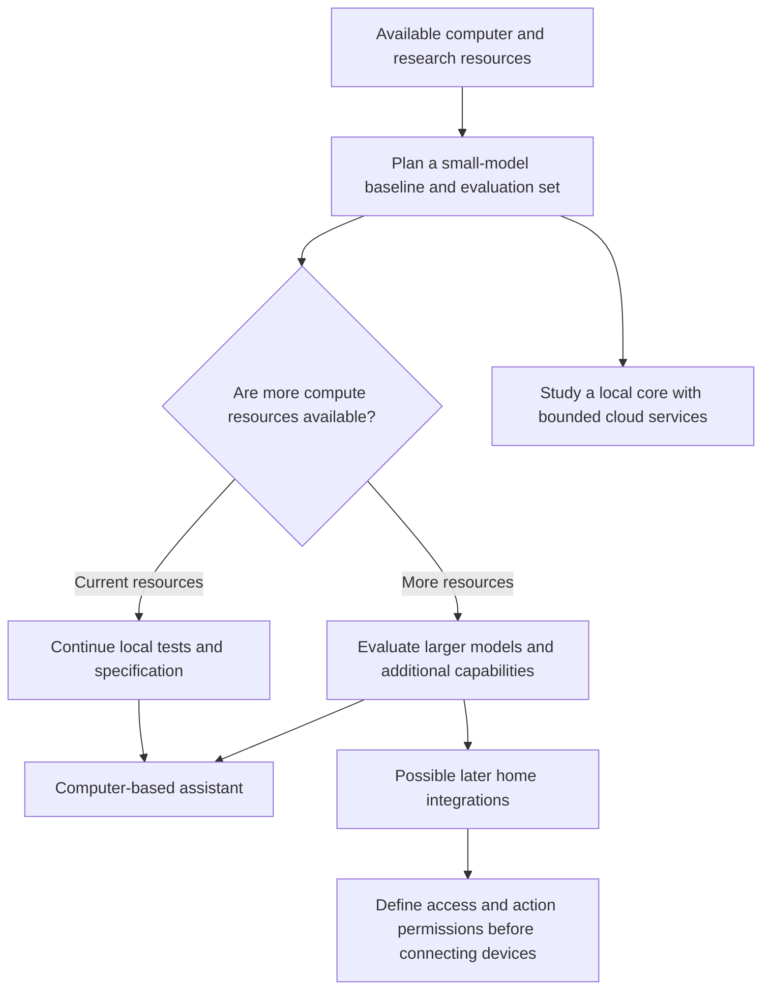
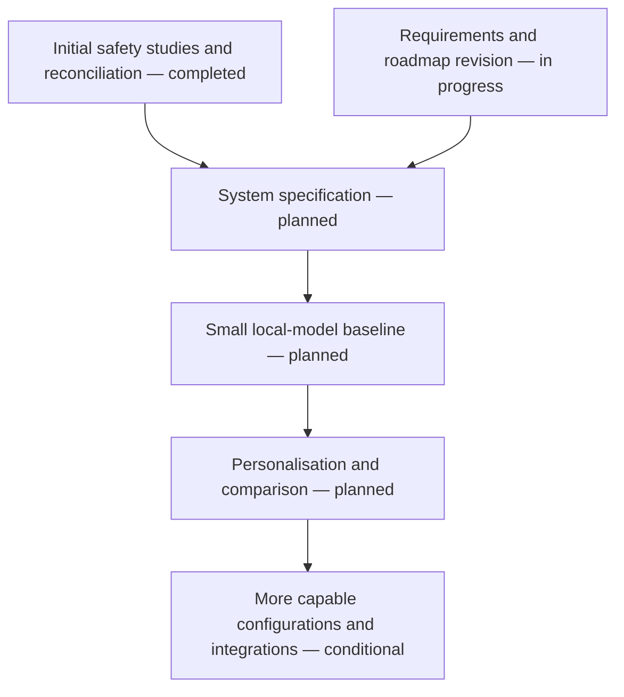

# Roadmap for a personal local language model

Public summary of the working roadmap as reviewed in November 2026. An independent review of the draft has been completed. Revisions and owner decisions remain open.

## Starting point and goal

At the [technical baseline](../evidence/2026-11-20-lab-progress.md), the lab had two candidate tools and had yet to start local inference. It aims to build an owner-controlled system that can adapt to the owner's language, working style and tasks, and to evaluate changes in behaviour against a baseline.

## Branches by resources and capabilities

The technical choices remain conditional on available resources, model support and the owner's priorities. The local-computer and possible hybrid directions are under study. Home integrations have their own access and permission requirements.

## Stages and dependencies

| Stage | Status | Evidence or decision needed to move forward |
|---|---|---|
| Define the system | In progress | Review the requirements and agree on the roadmap and initial scope. |
| Research and specify | Initial safety studies completed. Further work planned. | Produce the system specification, including behaviour, learning, access and safety. |
| Establish a small-model baseline | Planned | Record reproducible baseline results and the deployment state. |
| Test personalisation | Planned | Compare an adapted configuration with the baseline on agreed tasks. |
| Expand capabilities | Conditional | Confirm resources and rerun relevant checks before adding higher-impact capabilities. |

[How the roadmap was rebuilt](../cases/case-001.md) · [Safety research case](../cases/case-002.md) · [Proposed adaptation checks](../evidence/adaptation-evaluation-plan.md)
