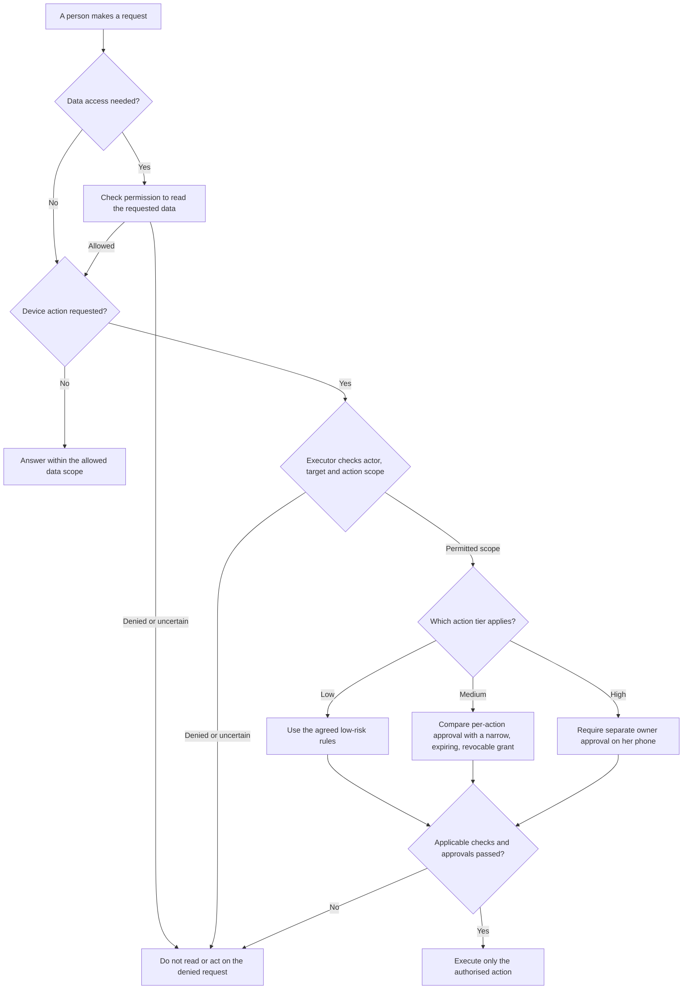
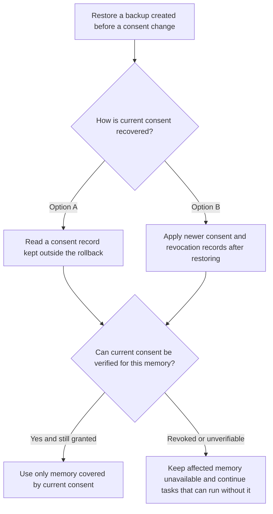

# Safety and memory decision diagrams

22 November 2026 · Research and planning

These diagrams show how the lab plans to check what the system may read, what it may do and what it may remember after a recovery. The diagrams describe the intended system and the tests planned for it.

## 1. Data access and permission to act

The roadmap separates permission to access data from permission to act and requires separate owner approval on her phone for high-risk actions. The medium-risk approval method is open. Voice alone does not authorise a medium-risk action. The executor check is a proposed way to enforce these requirements.

**Verification target.** Check that the selected Home Assistant version and configuration enforce the expected read and control permissions for the relevant actor and integration. Compare the two medium-risk concepts against the same synthetic scenarios: a permitted request, a request outside scope, an expired or revoked grant, and an unavailable authorisation check. For high-risk actions, check that execution stays blocked when separate phone approval is absent.

## 2. Memory consent after recovery

The system must respect a person's withdrawal of consent even after recovery. Both mechanisms are candidates. Keeping the affected memory unavailable is the proposed fallback when current consent cannot be verified. Storage and deletion behaviour across backups needs its own acceptance check.

**Verification target.** Use synthetic memory to test consent granted, consent revoked, then restoration of an older backup. Repeat with the current consent record unavailable. In both cases, check that the affected memory remains unavailable and that an unrelated permitted task can still proceed.

## Where the tests fit

| Roadmap phase | Evidence to prepare or collect |
| --- | --- |
| P2 — Specification | State the permission rules and recovery invariant. Compare alternatives against the same scenarios and write expected results. |
| P3 — Baseline and recovery | Test the permission rules in simulation and check baseline recovery using synthetic data. Record the version, settings and results. |
| P4 — Adaptation | Measure useful adaptation against the baseline and rerun the relevant regression checks against pre-set limits. |
| P5 — Integration | If home integration goes ahead, verify the selected version and configuration before connecting devices. |

[Roadmap](README.md) · [Planned checks for adaptation](../evidence/adaptation-evaluation-plan.md) · [Home Assistant LLM API](https://contributors.home-assistant.io/core/internals/llm-api/) · [Home Assistant permissions](https://contributors.home-assistant.io/core/internals/permissions/) · [OWASP on tool authorisation](https://cheatsheetseries.owasp.org/cheatsheets/AI_Agent_Security_Cheat_Sheet.html#tool-authorization-middleware)
